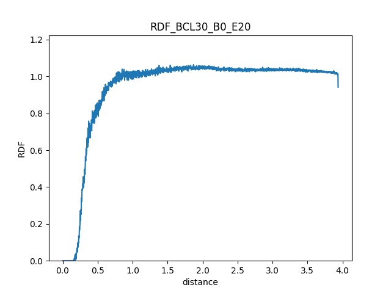

# gromacs_tools

Small command-line tools for analysing output of the
[GROMACS](https://www.gromacs.org/) molecular dynamics package.
You start it, pick a tool from a menu and answer a few questions.

Available tools:

1. **RDF change in time** – runs `gmx rdf` in consecutive time windows
   (e.g. 1500–1505 ps, 1505–1510 ps, …) to show how the solvation shell
   around a group changes during the simulation. Optionally draws one
   graph per window and joins them into an AVI movie.
3. **Angle vs axis** – reads an `.xvg` file with positions of atom pairs
   (e.g. from `gmx traj -ox`) and calculates, for each molecule, the angle
   between the pair vector and the X axis in the XY plane (−180° to 180°).
   Writes one file and one graph per molecule.

Options 2, 4, 5 and 6 in the menu (MSD, xyz to volume, H-bonds) are not
ready yet.



*Example RDF for one time window. A series of these graphs becomes the
frames of the movie.*

## Requirements

- Python 3.11 (other 3.x versions should work, but this is the one used)
- Python packages from `requirements.txt`: numpy, pandas, matplotlib,
  opencv-python (needed only for the movie)
- For the RDF tool: GROMACS with `gmx` available in the terminal
  (e.g. after `source GMXRC` or `module load gromacs`)

## Installation

gromacs_tools is not installed as a package. You download the folder
and run it from there.

```bash
git clone https://github.com/krzysztofmakuch/gromacs_tools.git
cd gromacs_tools
pip install -r requirements.txt
```

## Running

The tool uses package imports, so Python has to see the folder that
**contains** `gromacs_tools`. Start it with `python -m gromacs_tools`,
not `python gromacs_tools`.

File names you type are read relative to the current folder. The RDF
tool writes its output (XVG, PNG, movie) to the folder of the trajectory;
the other tools write to the current folder. It is easiest to go to the
folder with your simulation data and point `PYTHONPATH` at the parent
folder of `gromacs_tools`:

```bash
# Linux / macOS
cd /path/to/my_simulation
PYTHONPATH=/path/to/parent_of_gromacs_tools python -m gromacs_tools
```

```powershell
# Windows PowerShell
cd C:\path\to\my_simulation
$env:PYTHONPATH = "C:\path\to\parent_of_gromacs_tools"
python -m gromacs_tools
```

You will see the menu:

```
What do you want to do?:
 0. HELP
 1. RDF change in time
 2. MSD & diffusion - work in progress
 3. angle vs axis
 4. xyz to volume  - work in progress
 5. average number of H-bonds  - work in progress
 6. H-bond lifetime - work in progress
 q. quit
```

## Examples

The `tests` folder has sample data you can try both tools on.

### RDF change in time

Run from `tests/rdf_change_in_time` (needs `gmx`):

```
1
This program calculates solvatation RDF.
   XTC or TRR trajectory:
LUT_BCL30_100ps.xtc
   TPR file:
LUT_BCL30_100ps.tpr
   NDX file:
index.ndx
   output XVG names. Give name for one file with xvg extension. Don't add numbering:
RDF_BCL30.xvg
   Begin RDF time:
0
   End RDF time:
100
   Single RDF time:
20
   Group to calculate solvatation RDF for:
BCL
Do you want to create movie covering the RDF change - Y/N?
Y
```

The RDF is calculated against water (group `SOL`). Output, written to the
folder of the XTC file (unless the output name includes a folder):

- `RDF_BCL30_B0_E20.xvg`, `RDF_BCL30_B20_E40.xvg`, … `RDF_BCL30_B80_E100.xvg`
  – one RDF per time window
- the same names with `.png` – one graph per window, all with the same
  y-axis scale
- `RDF_BCL30_film.avi` – the graphs joined into a movie, one frame per window

### Angle vs axis

Run from `tests/angles_from_positions`. The input file has a time column,
then for each molecule x y z of atom 1 followed by x y z of atom 2.
`vec_test.xvg` holds 6 molecules in 3 dimensions:

```
3
This program converts positions of atoms into angles between a vector and 0X axis.
 Provide the program with a filename and number of dimensions in your xvg file.
   filename:
vec_test.xvg
   dimensions:
3
```

Output, for each molecule `N`:

- `vec_test_vec_out_N.xvg` – vector between the two atoms
- `vec_test_vec_norm_out_N.xvg` – the vector normalised in the XY plane
- `vec_test_angle_out_N.xvg` – time and angle to the X axis
- `vec_test_angle_out_N.png` – graph of the angle in time

## Tests

From the folder that contains `gromacs_tools`:

```bash
python -m pytest gromacs_tools/tests
```

## License

This tool is available under MIT licence described in LICENSE file.
